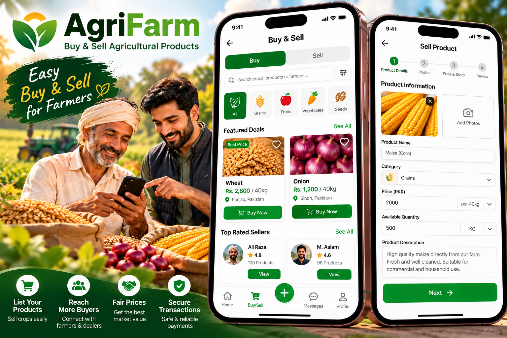
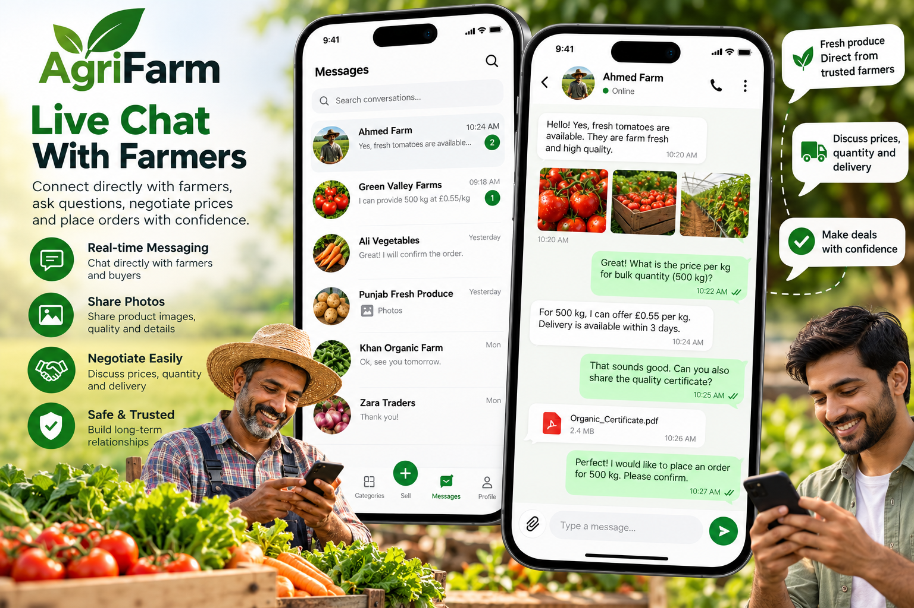
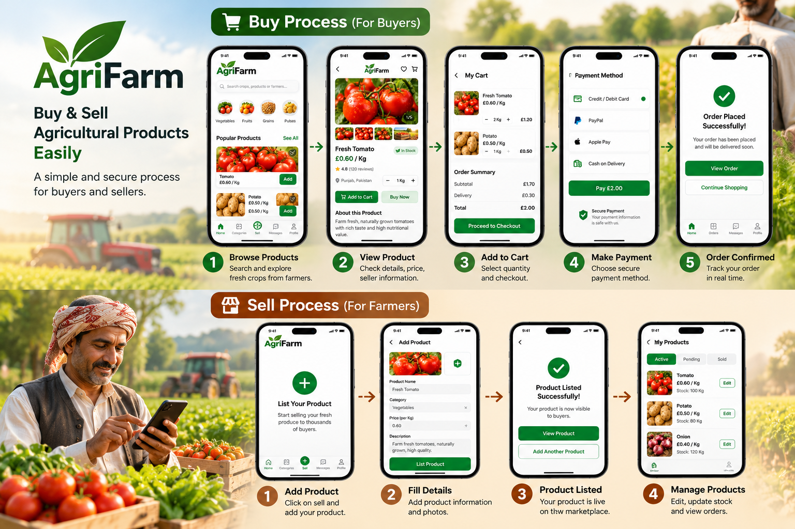

# AgriFarm: Farm Marketplace App (Flutter)

**A marketplace where farmers sell their crops directly to buyers, with live chat between them.**

Built by [Oriental Tech Solutions](https://github.com/OrientalTechSolutions) · Flutter

---

## Screenshots

## The need

Farmers needed a direct way to list their crops and talk to buyers in one app, without middlemen.

## What we built

- **Crop listings for farmers:** add a product with photos, category, price, quantity and description
- **Browse and buy for buyers:** categories (grains, fruits, vegetables, seeds), featured deals, top-rated sellers
- **Live farmer-to-buyer chat:** ask about price, quantity and delivery, and share documents such as quality certificates
- **Buy & Sell modes** in one app

## Tech stack

`Flutter` `Dart` `Real-time chat` `REST API` `Push notifications`

## Our role

UI implementation, app development, listings and chat, testing and release.

---

> 🔒 **Source code is private.** This is a client project and the code belongs to the client. This repository shows the features, screens and technology used.

**Need a marketplace or chat app?** [Hire us on Upwork](https://www.upwork.com/freelancers/attaullahhazarvi)
